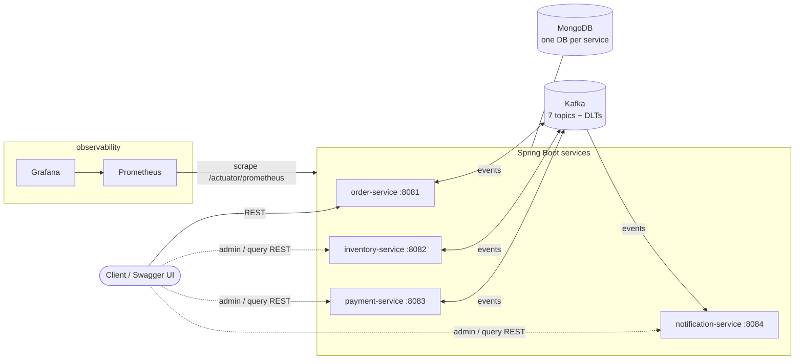
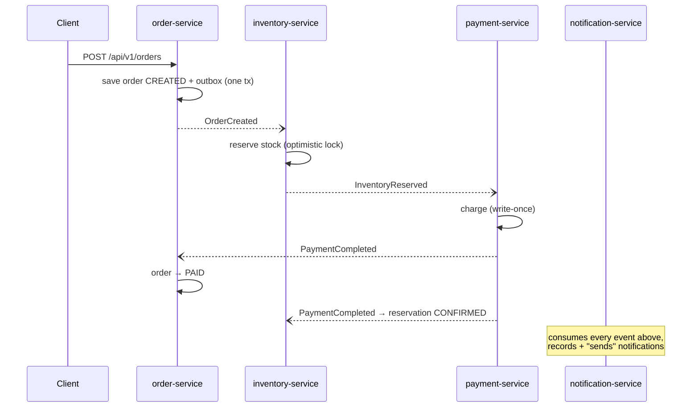
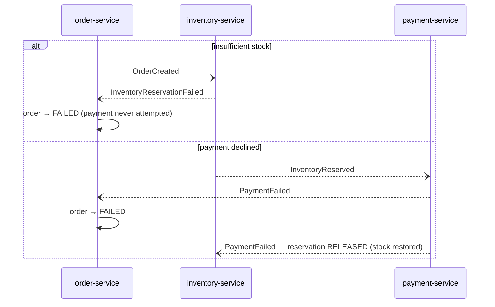

# Architecture

The platform processes orders as a **choreographed saga**: no central
orchestrator, each service reacts to events and emits its own
([ADR-0001](adr/0001-saga-choreography.md)). Services share nothing but the
event contracts in `common/common-events`; each owns its MongoDB database.

## System overview

## Saga flows

Happy path — every hop is an event over Kafka; the correlation ID from the
initial HTTP request travels in event headers and every log line:

Compensation — payment failure releases the reservation; inventory failure
fails the order before payment is ever attempted:

## Event catalog

Events travel as a versioned JSON **envelope** (`eventId`, `eventType`,
`occurredAt`, `correlationId`, `payload`) with tolerant readers
([ADR-0005](adr/0005-envelope-versioning-tolerant-readers.md)). Topics are
partitioned by order ID (3 partitions), so each order's events stay ordered.

| Topic | Event type | Producer | Consumers |
|---|---|---|---|
| `order-created` | `OrderCreated` | order (via outbox) | inventory, notification |
| `order-cancelled` | `OrderCancelled` | order (via outbox) | inventory, notification |
| `inventory-reserved` | `InventoryReserved` | inventory | payment, order, notification |
| `inventory-failed` | `InventoryReservationFailed` | inventory | order, notification |
| `payment-success` | `PaymentCompleted` | payment | order, inventory, notification |
| `payment-failed` | `PaymentFailed` | payment | order, inventory, notification |
| `notification-sent` | `NotificationSent` | notification | — (audit) |

Each consumed topic has a matching dead-letter topic with suffix `.DLT`
(e.g. `order-created.DLT`). Topic auto-creation is disabled; every service
declares the topics it produces and the DLTs it owns.

## Key patterns

- **Transactional outbox** (order-service only) — the order and its event are
  written in one Mongo transaction; a scheduled relay publishes to Kafka in
  order and stops the batch on failure
  ([ADR-0003](adr/0003-transactional-outbox-order-service.md)). Downstream
  services publish after commit instead — an accepted, smaller risk window.
- **At-least-once + idempotent consumers** — every listener runs a
  deduplication pipeline keyed by `eventId` (`common-kafka`), with processed
  markers expiring after 7 days
  ([ADR-0002](adr/0002-at-least-once-idempotent-consumers.md)).
- **Blocking retries, then DLQ** — exponential backoff in the consumer thread
  preserves per-key ordering; poison pills route to `<topic>.DLT` with
  diagnostic headers ([ADR-0006](adr/0006-blocking-retries-preserve-ordering.md)).
- **No oversell** — stock reservation uses optimistic locking (`@Version`) with
  a two-phase reserve → confirm/release lifecycle; a released *tombstone*
  handles the cancel-overtakes-create race.
- **State-machine order aggregate** — downstream events drive explicit
  transitions; unexpected transitions increment a `saga.anomalies` metric
  instead of corrupting state.

## Observability

- Every service exports Micrometer metrics at `/actuator/prometheus`, tagged
  with `application=<service>`. Business metrics include
  `payment_processed_total{outcome}`, `inventory_reservations_total`,
  `notifications_sent_total{type}`, `events_published_total{topic}`,
  `outbox_published_total`, `kafka_dlq_messages_total`, and `saga_anomalies_total`.
- Prometheus scrapes statically in Compose and by pod annotation in Kubernetes.
- Grafana provisions a 13-panel dashboard (orders/min, payment success rate,
  consumer lag, DLQ, retries, saga anomalies, HTTP p95, JVM) from
  `infra/grafana/dashboards/ecommerce-platform.json` — dashboards as code.
- A correlation ID enters at the HTTP edge (`common-web` filter), rides every
  event header, and lands in every JSON log line via MDC.

## Module structure

Each service follows the same hexagonal-lite layout: `domain` (aggregates,
ports — no framework imports), `application` (use cases, event handlers),
`adapters` (REST in, Mongo + Kafka out), `config`. The three `common` modules
are internal starters: contracts (`common-events`), HTTP concerns
(`common-web`), and the Kafka consumption pipeline (`common-kafka`).
